  <h3><code>vinicius@github ~ $ ./contributions.sh</code></h3>
  
    
  <h3><code>vinicius@github ~ $ whoami</code></h3>
  <table>
    <tr>
      <td valign="top"></td>
      <td valign="top"></td>
    </tr>
  </table>

  
  &nbsp;
  

## Projetos

| Projeto | O que é hoje |
|---|---|
| [GastoJá](https://www.gastoja.com.br/) | Gastou, manda agora, registra já — controle de gastos com registro rápido. |
| [Pix Race](https://github.com/viniciusbertoquintino/jev-testes/tree/main/jev-pix-falso) | Demo em tela dividida (Rust + Jev e Python + DeepSeek) que classifica golpe de Pix e rastreia o caminho do dinheiro num grafo. Os dados são simulados. |
| [Jev Self-Driving Sim](https://github.com/viniciusbertoquintino/jev-testes/tree/main/jev-carro-autonomo) | Carro 2D no browser. O Jev responde quatro perguntas tipadas e o código aplica o gating de confiança. O modo Compare roda o mesmo percurso contra um LLM. |
| [Production RAG](https://github.com/viniciusbertoquintino/production-rag) | RAG com qualidade de retrieval, avaliação e observabilidade. Em desenvolvimento. |
| [Plataforma de Assistentes com IA](https://github.com/viniciusbertoquintino/plataforma-assistentes-ia) | Plataforma funcional de LLMs, RAG e agentes (React, Supabase e FastAPI opcional). A evolução segue o roadmap do projeto. |
| [AI Project Kit](https://github.com/viniciusbertoquintino/ai-project-kit) | Kit de documentação e contexto para projetos com IA, agentes e desenvolvimento assistido por LLMs. |
| [Quadro de agentes](https://github.com/viniciusbertoquintino/quadro-agentes) | Quadro para organizar e acompanhar agentes de IA. Em desenvolvimento incremental. |

Também: [caderno de estudos](https://github.com/viniciusbertoquintino/meu-caderno-ia) — desenvolvimento incremental; o app ainda não existe.

---

## English

### Projects

| Project | What it is today |
|---|---|
| [GastoJá](https://www.gastoja.com.br/) | Spend it, send it now, log it — quick expense tracking. |
| [Pix Race](https://github.com/viniciusbertoquintino/jev-testes/tree/main/jev-pix-falso) | Split-screen demo (Rust + Jev and Python + DeepSeek) that classifies Pix scams and traces the money through a graph. The data is simulated. |
| [Jev Self-Driving Sim](https://github.com/viniciusbertoquintino/jev-testes/tree/main/jev-carro-autonomo) | A 2D car in the browser. Jev answers four typed questions and the code applies confidence gating. Compare mode runs the same course against an LLM. |
| [Production RAG](https://github.com/viniciusbertoquintino/production-rag) | RAG with retrieval quality, evaluation, and observability. In progress. |
| [AI Assistants Platform](https://github.com/viniciusbertoquintino/plataforma-assistentes-ia) | A working LLMs, RAG, and agents platform (React, Supabase, and an optional FastAPI backend). It moves forward on its own roadmap. |
| [AI Project Kit](https://github.com/viniciusbertoquintino/ai-project-kit) | A documentation and context kit for projects that use AI, agents, and LLM-assisted development. |
| [Agent board](https://github.com/viniciusbertoquintino/quadro-agentes) | Board to organize and track AI agents. Incremental development. |

Also: [study notebook](https://github.com/viniciusbertoquintino/meu-caderno-ia) — incremental development; the app does not exist yet.
